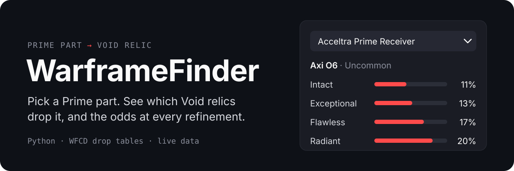
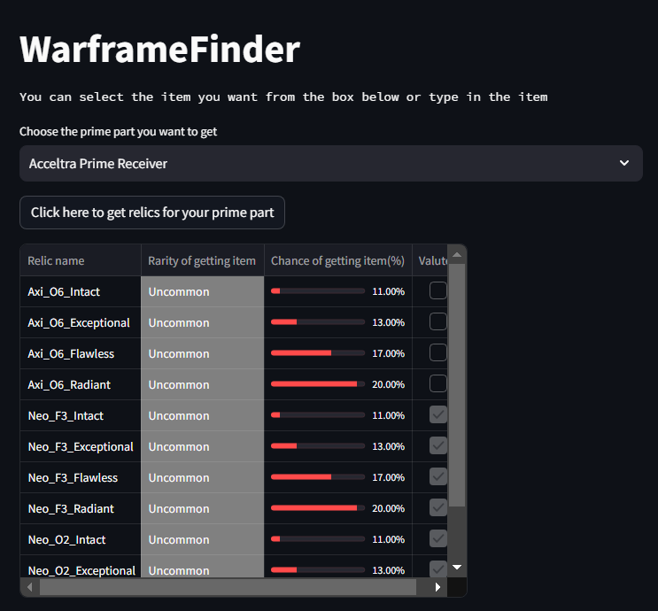
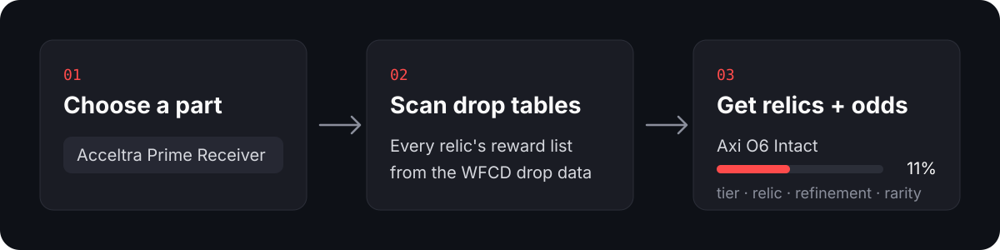

<p align="center">
  
</p>

<p align="center">
  
</p>

## What it is

WarframeFinder is a small Python tool for Warframe players farming Prime parts. Give it a part name, such as `Acceltra Prime Receiver`, and it lists every Void relic that contains the part, with the part's rarity and drop chance for each refinement level (Intact, Exceptional, Flawless, Radiant).

It reads live data from the official drop tables, published as an API by the [Warframe Community Developers](https://github.com/WFCD/warframe-drop-data). You don't need to keep a local copy of the drop tables.

## How it works

<p align="center">
  
</p>

| File | Job |
| --- | --- |
| `main.py` | Downloads the drop tables. `findPrimePartLocation(part)` lists relics for a Prime part. `getFarmlocation(relic)` lists mission nodes that reward a relic. |
| `warframeItem.py` | Saves the warframe.market item list to `WarframeItem.json`, which `main.py` loads at start-up |
| `test.py` | Early PySimpleGUI window, still a work in progress |

## Quick start

Requires Python 3 and `requests`.

```bash
git clone https://github.com/ThunderIW/WarframeFinder.git
cd WarframeFinder
pip install requests

python warframeItem.py   # creates WarframeItem.json
python -c "from main import findPrimePartLocation; findPrimePartLocation('Acceltra Prime Receiver')"
```

Output:

```text
Acceltra Prime Receiver
Name:Axi O6
State:Intact
Rarity:Uncommon
Chance:11%
----------------------------------------------------------
Acceltra Prime Receiver
Name:Axi O6
State:Exceptional
Rarity:Uncommon
Chance:13%
...
```

> [!NOTE]
> The warframe.market v1 endpoint used by `warframeItem.py` currently returns HTTP 403. The relic lookup doesn't need the item list, so you can create an empty one and carry on:
> `echo [] > WarframeItem.json`

## Limitations

- `getFarmlocation` only checks mission nodes on Mercury and Venus so far.
- Results are printed to the console. The interface in the screenshot isn't part of this repository yet.
- Part names must match the drop tables exactly, e.g. `Acceltra Prime Receiver`.

## Credits

Drop data: [WFCD/warframe-drop-data](https://github.com/WFCD/warframe-drop-data) · Item list: [warframe.market](https://warframe.market)

WarframeFinder is a fan project and is not affiliated with Digital Extremes. Warframe is a trademark of Digital Extremes Ltd.
